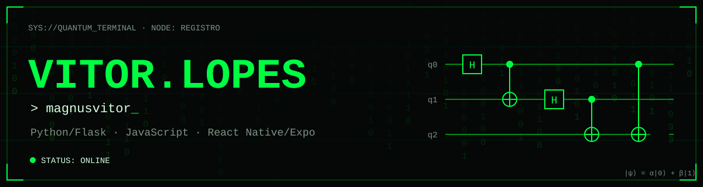

<div align="center">



```
INITIALIZING PROFILE...
LOADING TECHNICAL DATA...
SYSTEM STATUS: ONLINE
```

<sub>`[ 01 ] INIT` · `[ 02 ] IDENTITY` · `[ 03 ] STACK` · `[ 04 ] EXPERIMENTS` · `[ 05 ] TELEMETRY` · `[ 06 ] INTERESTS` · `[ 07 ] NETWORK`</sub>

</div>

---

## `02 // IDENTITY_PROTOCOL`

```yaml
nome:       Vitor Lopes
handle:     magnusvitor
origem:     Registro
formacao:   Etec de Registro
foco:       desenvolvimento web (Python/Flask) e mobile (React Native/Expo)
```

Desenvolvo aplicações web com Flask e apps mobile com React Native/Expo.
Meus repositórios públicos reúnem o material de estudo de Programação Web
(PW3, Etec de Registro) e o app do meu TCC.

> *"Os cenários postos diante de nós têm como único objetivo saber se somos dignos de nossos desejos."*

---

## `03 // TECHNICAL_STACK`

Somente tecnologias presentes nos repositórios públicos.

| Categoria | Tecnologias |
|:--|:--|
| **Languages** |    |
| **Backend** |   |
| **Mobile** |    |
| **Tools** |    |

---

## `04 // FEATURED_EXPERIMENTS`

<table>
<tr>
<td width="50%" valign="top">

**`EXPERIMENT_001`**
### [Tcc_vigia](https://github.com/magnusvitor/Tcc_vigia)

App mobile do meu TCC na Etec de Registro, feito em React Native com Expo.

`JavaScript` `React Native` `Expo` `React Navigation` `Axios`

[`> ACCESS_REPO`](https://github.com/magnusvitor/Tcc_vigia)

</td>
<td width="50%" valign="top">

**`EXPERIMENT_002`**
### [pw3-python-flask](https://github.com/magnusvitor/pw3-python-flask)

Material de aulas de PW3: Flask, templates, MVC, CRUD com banco de dados, login, integração com APIs, upload de arquivos e chat com WebSocket.

`Python` `Flask` `HTML` `WebSocket`

[`> ACCESS_REPO`](https://github.com/magnusvitor/pw3-python-flask)

</td>
</tr>
</table>

<sub>Mais projetos: [repositórios públicos](https://github.com/magnusvitor?tab=repositories)</sub>

---

## `05 // SYSTEM_TELEMETRY`

<div align="center">


</div>

---

## `06 // TECHNICAL_INTERESTS`

```
[ DEMONSTRATED ]
 > Web back-end com Flask: MVC, CRUD, autenticação, APIs, WebSocket
 > Apps mobile com React Native e Expo
```

---

## `07 // NETWORK_ACCESS`

```
$ connect --target magnusvitor
```

[](https://www.linkedin.com/in/vitor-cardoso-da-silva-lopes-a40796333/)
[](https://www.instagram.com/vcsl.10/)
[](https://t.me/Auticimus)

<div align="center">

```
|ψ⟩ = α|0⟩ + β|1⟩ — enquanto ninguém mede, tudo ainda é possível.
```

</div>
